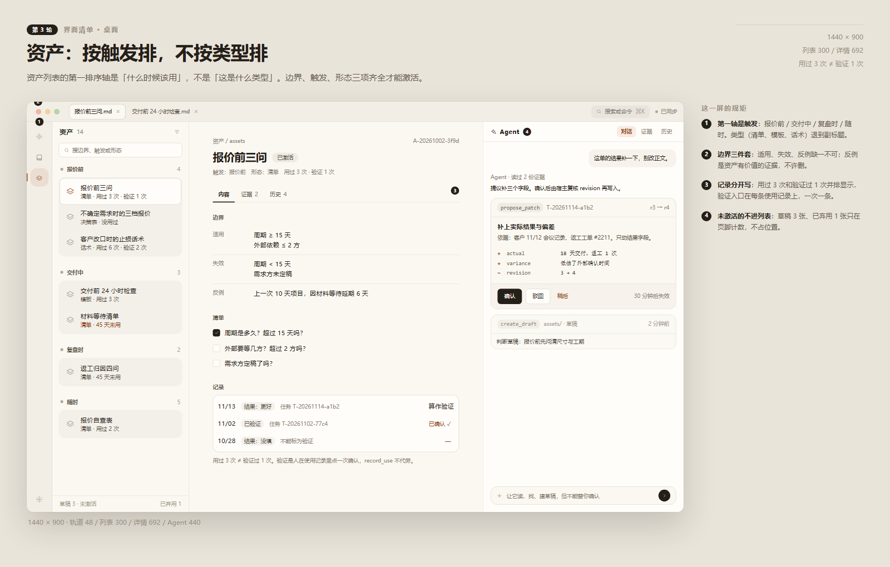
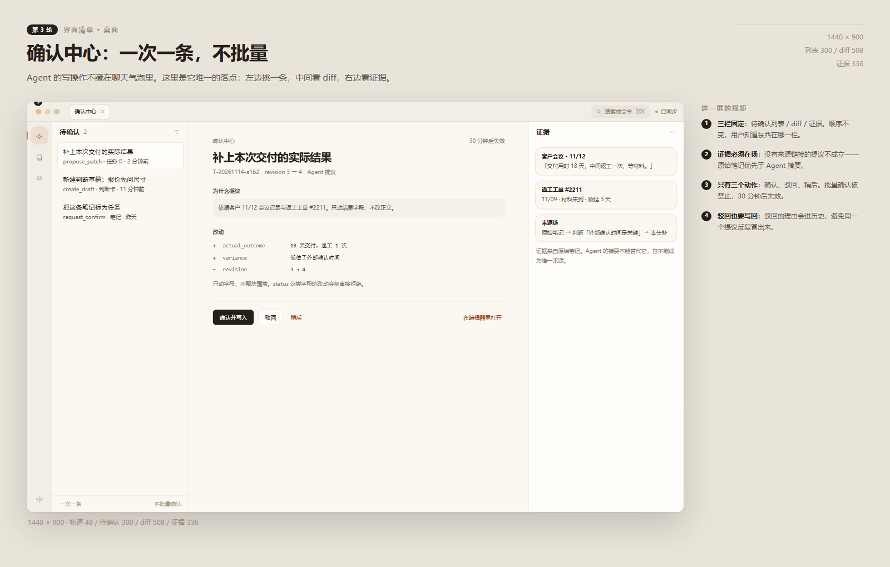
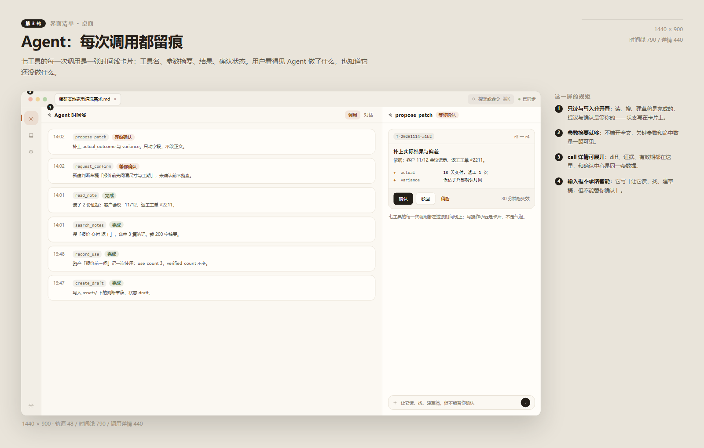

# 界面画板 · 目标界面（screens/ 十屏）

> 本目录只剩一样东西：**已批准的目标界面画板**。界面任务 = 逐屏把实现做成这些画板的样子。
> 入库 2026-11-16 · 清理 2026-11-16：删除非目标材料，只留 `screens/`（下有删除留档）· **评审修订 2026-11-16**：源值按《界面改造方案》§4.4 裁决 14–25 收敛（圆角归 {2 · 4 · 8 · 14 · pill}、半像素字号废除、系统字体栈、悬浮钮 48），注记数值以 HTML 实测为准，PNG 同批重渲染替换；`ui-all` 里的设备外壳插画圆角（48px）是装置插画，不属界面 token 词汇。

## 地位

- `screens/` 十屏是本项目界面改造的**唯一设计权威**；画板声明的尺寸与写法就是目标值。
- 权威顺序不变：**画板声明的尺寸 > `docs/design/design-language.md` > 平台规范（Fluent / Apple HIG）**（《界面改造方案》§4 有裁决的除外）。
- **源文件是数值的唯一出处**：图上量出的数可能带误差，要精确值就打开同名 HTML——`screens/ui-d-today.html` 画出 `screens/ui-d-today.png`，图与源一一对应，源文件里能看到画板声明的每一个数值（宽度、行高、字号、颜色变量）。
- 新增画板只进 `screens/`，并在此 README 记一行。

## 已删除的材料（别找，别当目标）

2026-11-16 清理，以下四个目录已从仓库删除（git 历史可查）：

| 删掉的目录   | 曾是什么                                       | 为什么删                                                                                              |
| ------------ | ---------------------------------------------- | ----------------------------------------------------------------------------------------------------- |
| `directions/`| 三份方向稿（A 连续面已被 screens 取代；B/C 未批准）| 未批准稿曾被误当目标（2026-11-16 评审事故的成因）                                                    |
| `skeleton/`  | A 方案骨架五张（断点阶梯、行与三段式等）        | 推导材料；断点与行的落地数值已收入《界面改造方案》§2.2                                                |
| `shots/`     | 旧实现的落地截图九张                            | 旧实现不是参照物；证据以任务清单里的提交号为准，旧图 git 历史 v0.2 之前可查                            |
| `skins/`     | 四款配色对照（石墨 / 亮纸 / 苹果 / Craft）      | 裁决 13：留作未来主题库参考、不入当前工作线（裁决原文见《界面改造方案》§4.3；对照文件本体已删）        |

## 界面清单（screens/ 十屏）

桌面七屏 + 手机两板 + 总览，同一套 token、同一条三段式。

### 总览：一张图看全部界面

### 桌面 · 今天 —— 队列即首页，五个固定分组

### 桌面 · 笔记 —— 文件树 + Markdown 编辑器（编辑区单岛平铺，裁决 12）

### 桌面 · 资产 —— 按触发排，边界三件套

### 桌面 · 确认中心 —— 列表 / diff / 证据三栏

### 桌面 · Agent 时间线 —— 每次调用一张卡片

### 桌面 · 收集 —— 浮层，不占轨道位置

### 桌面 · 设置 —— 弹窗面板，不占一轨

### 移动端 · 今天 / 笔记 / 收集 / 资产 —— 底栏 56 + 安全区 34，触栏 44 起

### 移动端 · 详情 / 确认 / Agent / 更多 / 设置

## 怎么用这份画板

1. **改界面 = 把实现做成画板的样子**：画板写死的数值就是目标值，不许用平台规范的默认值覆盖它（除非《界面改造方案》§4 记了裁决）；
2. **画板与实现不一致时**：先改画板（重新设计）还是先改实现（对齐）是一次裁决——裁决要落到《界面改造方案》§4 的表里，别只留在对话里；
3. **开工顺序与各屏的数据依赖看《改造任务清单》§4**：本 README 只管"目标长什么样"，不管进度。
