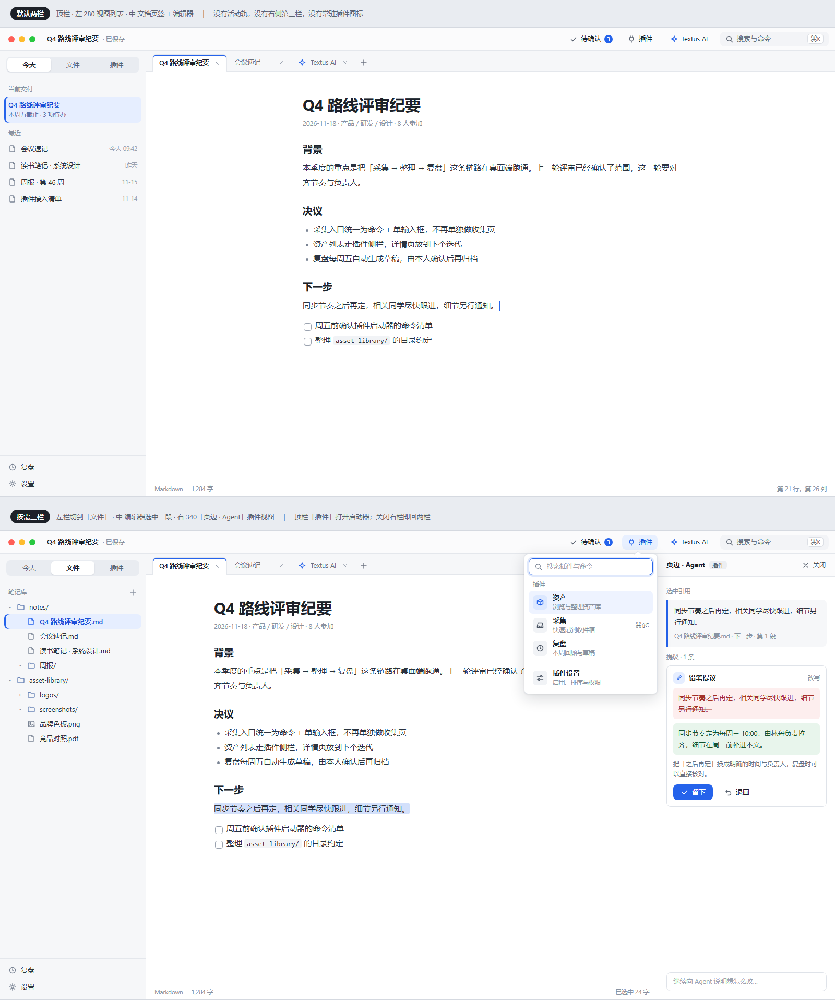

# 笔记理论的传统界面落点（考虑稿）

> 版本：v0.2
> 日期：2026-11-20
> 状态：**考虑稿，未裁决，不施工**。作为后续实现方向的输入，不改变现行裁决。
> 关联：《笔记资产理论》《Textus-Agent工具契约》《插件API要点》《Textus-改造方案》《界面现状盘点》
> 结论先行：**能。资产闭环走插件；导航入口只做一次小改（两栏默认、三栏按需、活动轨退场、插件入口进顶栏），不是重画宿主壳层。**
> 2026-11-20 用户看过原宿主改造图，判「这版不错，界面排版以及功能分区后面可以再优化优化」；方向记录在 §2.2，仍未裁决、未施工。

---

## 0. 结论

笔记理论需要的是**行为与状态**，不是某种三栏排版：

- 自由笔记 → 有编辑器；
- 这一单 / 草稿 / 资产 → 有 front matter 和列表筛选；
- 七行收尾 → 有一个“收尾时刻”的表单或旁边视图；
- 按触发取回 → 当前笔记是“这一单”时，能看见可用资产；
- 人工确认 → 有原生“接受 / 退回”的提议 UI；
- 复用记录 → 有一个右键动作或命令；
- 复盘 → 有一个低频视图。

Textus 现有宿主已经具备这些表面：侧栏、文档页签、编辑器、分栏、AI 页签/面板、窗口状态项、右键菜单、对话框。插件 API 又把“贴着当前笔记做事”的口子开出来了：`registerContextMenu`、`editor.propose`、`statusItem`、`openView(... { where: "beside" })`、`registerList`、`ui.form`、`ai.complete`、`ai.registerTool`。

所以：**把资产闭环做成插件，跑在传统布局上。** 资产闭环本身不需要改壳；但导航入口需要一次独立的小改：活动轨退场、左栏变视图列表、插件入口进顶栏启动器。这是 H0，不是重画壳，也不是三栏重设计。详见 §2.2。

---

## 1. 这份文档回答什么

前几轮界面探索（A/B/C/D/D3）把“壳”当成问题：三栏、四刻、页脊、单卡、页边。结果是每版都在重新安排空间，却没有回答一个更基础的问题：

> 现有宿主这个传统布局，能不能把理论跑起来？

本文的答案是能，并把“怎么落”写成一张可核对的映射表。本文不是新画板，不是施工单；资产闭环部分不需要改 `src/` / `src-tauri/`；H0 导航入口若做，另开施工项。

---

## 2. “传统布局”指什么

指 Textus 现有宿主。**改造前**是：

- 左侧活动轨（48px）+ 侧栏页签（文件 / 大纲 / 搜索 / 插件）
- 文档页签（可拖排序、拖出窗口、分栏）
- 中央编辑器（Milkdown / 源码模式）
- AI 页签 / 面板（桌面为页面页签，可拖到分栏；iOS 为停靠面板）
- 设置对话框 / 面板
- 窗口栏状态项、右键菜单、对话框、通知
- 插件可加：侧栏页签、列表视图、webview 视图、状态项、命令、右键菜单项、表单、设置页

改造后保留窗栏、文档页签、编辑器、AI 页签、设置；只动导航入口。

### 2.1 为什么不能靠“三栏”解决

前几轮一直在改布局，根因不是栏数，而是导航入口：

- 活动轨 + 侧栏不好看 → 想关掉；
- 关掉后插件页签、文件 / 搜索 / 大纲没地方放 → 又加回来；
- 加回来又变成一根不喜欢的栏 → 换三栏 / 四刻 / 页边；
- 三栏只是把栏变宽，入口问题没解决。

三栏不会让导航栏消失，只会让它变成两根。现代感来自“默认没有导航栏”，不是“换一种三栏”。

### 2.2 导航入口模型：两栏默认，三栏按需

**默认两栏**：左 280 视图列表（今天 / 文件 / 插件）+ 文档页签 + 编辑器；没有 48px 活动轨，没有右侧第三栏，没有永久插件图标。

**按需三栏**：左栏切到“文件”或“插件”，中间编辑器；右侧 340 是插件视图（页边 · Agent / 资产 / 收尾），从顶栏或命令打开；关掉就回两栏。

**插件入口**：顶栏一个“插件”按钮 + `⌘K` 命令面板；插件页打开成 tab 或 beside 分栏；常驻信号放窗口状态项。不要每个插件一个永久图标。

**侧栏**：文件 / 大纲 / 搜索 / 插件 / 资产收进左栏视图切换或抽屉，默认可收起；不占永久宽度。



> 原图：`host-nav-2026-11-20.png`（1600×1916）。可缩放源：`host-nav-2026-11-20.html`（独立 HTML，浏览器打开）。这是 2026-11-20 opencode 按原宿主壳画的改造图，不是 D3 的暖纸概念；用户判「这版不错，界面排版以及功能分区后面可以再优化优化」。

这套布局仍然是传统布局：侧栏、页签、编辑器、分栏、AI 面板都在，只是默认收起 / 按需出现。本文不新增一级业务入口；导航入口只做这一次（H0）。

---

## 3. 理论与传统布局的映射

| 理论要求        | 传统布局 / 插件落点                                                                                                  | 依据                                                      |
| --------------- | -------------------------------------------------------------------------------------------------------------------- | --------------------------------------------------------- |
| 执行期自由笔记  | 现有编辑器；不受字段约束                                                                                             | 宿主                                                      |
| 任务卡 / 资产卡 | Markdown + front matter；类型、状态、边界、触发、复用形态                                                            | `files`、`metadata`                                       |
| 这一单的状态    | front matter `type/status` + 侧栏列表筛选 + 状态 chip                                                                | `metadata`、`registerList`                                |
| 七行收尾        | `ui.form` 七字段；或 `openView(..., { where: "beside" })` 在旁边开收尾视图；也可 `editor.propose` 把七行块提议进笔记 | `ui.form`、`Layout.openView`、`Editor.propose`            |
| 人工确认        | `editor.propose` 原生“接受 / 退回” diff；`ui.confirm`                                                                | `Editor.propose`、`Ui.confirm`                            |
| 资产库          | 插件侧栏页签 + `registerList`；按状态 / 触发 / 7 天 / 30 天过滤                                                      | `contributes.sidebarTabs`、`Views.registerList`           |
| 按触发取回      | 窗口状态项“这一单 · 2 条可用 · 3 待确认”，点开 `ui.pick` 列表；`onDidChangeActive` 跟着当前笔记更新                  | `Ui.statusItem`、`Editor.onDidChangeActive`               |
| 复用记录        | 右键菜单 / 命令 “记一次使用” → `frontmatter.update`                                                                  | `Ui.registerContextMenu`、`files`                         |
| 复盘            | 插件视图（list / webview），低频打开；三个问题 + 陈旧清单                                                            | `contributes.views`、`openView`                           |
| Agent 工具      | `contributes.aiTools` + `ai.registerTool`；宿主 AI 面板调用                                                          | `Ai`                                                      |
| 页内改写        | 选中文本 → 右键 “问 / 改 / 提炼” → `ai.complete` → `editor.propose`                                                  | `Ui.registerContextMenu`、`Ai.complete`、`Editor.propose` |
| 捕获            | 命令 + `ui.input`，落到 `inbox/`                                                                                     | `Commands`、`Ui.input`、`files`                           |
| 写入与历史      | `files.process` / `frontmatter.update`（带版本 token）；`_history`                                                   | `files`、`ctx.storage.project`                            |

---

## 4. 插件 API 的关键口子

以下名称与行为以 `docs/dev/plugins/reference.md` 为准；本节只记与理论落点相关的部分。

### 4.1 右键菜单：`ui.registerContextMenu`

```ts
ui.registerContextMenu("editor" | "fileTree", (target) => {
  // target: { path: string | null; folder?: boolean; selectedText?: string }
  return [
    { label: "问 Agent", command: "<plugin>.ask" },
    { label: "改", command: "<plugin>.rewrite", args: [target.selectedText] },
    { label: "提炼", command: "<plugin>.extract" },
    { label: "标成这一单", command: "<plugin>.markTask" },
    { label: "收尾", command: "<plugin>.close" },
    { label: "记一次使用", command: "<plugin>.recordUse" },
  ];
});
```

- 这是**编辑器原生右键菜单**，不是 OS 选择工具栏，也不是自定义浮条。
- 能拿到当前文件路径和选中文字；菜单项点击后执行命令。
- 0.5 秒内返回；适合按当前文件 / 选区分支。
- 这一口子解决了“浮条和系统工具栏重叠”的问题：动作不再飘在正文上。

### 4.2 页内提议：`editor.propose`

```ts
await editor.propose(change, { reason: "把这段改清楚" });
```

- 以 Textus AI 的方式显示提议，用户“接受 / 退回”。
- `editor.getSelection()` 取选区；`editor.edit()` / `insertText()` / `replaceSelection()` 写入。
- `onDidChangeActive` / `onDidChangeSelection` 让插件知道当前笔记和选区。
- 不需要自定义页边，也不需要改编辑器 schema。

**这是“Agent 像铅笔”的原生实现**：提议贴在内容上，人逐条接受或退回。

### 4.3 状态项：`ui.statusItem`

```ts
const item = ui.statusItem("current-task", {
  text: "这一单 · 2 条可用 · 3 待确认",
  tooltip: "开工前该看的资产",
  command: "<plugin>.showAssets",
});
item.update({ text: "这一单 · 1 条可用" });
```

- 窗口 / 状态栏的一项，可点击执行命令。
- 在 `editor.onDidChangeActive` 里读取当前笔记 front matter，更新文案。
- 这是传统布局里“当前这一单”的常驻提示，不需要左栏。

### 4.4 按需分栏：`workspace.openView(..., { where: "beside" })`

```ts
await workspace.openView("<plugin>.task-panel", { where: "beside" });
```

- 在当前笔记旁边开一个插件视图（`contributes.views` 的 `list` 或 `webview`）。
- `where: "beside"` 会在当前窗格旁分栏；不是常驻三栏。
- 可以放“这一单”“收尾”“资产详情”；用户关掉就回到单栏。
- 也可以用 `workspace.split()`、`showSidebarTab()` 打开宿主原生分栏 / 侧栏。

### 4.5 资产列表：`contributes.sidebarTabs` + `registerList`

- 插件侧栏页签，Textus 代画列表 / 过滤 / 键盘。
- 资产库就是一个侧栏列表，不是一级导航。
- 列表项可按 front matter 状态、触发阶段、7 天未验证、观察期、30 天未调用过滤。

### 4.6 表单与确认：`ui.form` / `ui.confirm` / `ui.pick` / `ui.notice` / `ui.input`

- 七行收尾：`ui.form` 七个字段（情境 / 动作 / 预期 / 实际 / 偏差 / 边界 / 触发）。
- 选资产：`ui.pick`，支持搜索、多选、命令项。
- 危险动作：`ui.confirm`（可 danger）。
- 轻提示：`ui.notice`，可带 Undo。
- 捕获：`ui.input`。

### 4.7 AI：`ai.complete` / `ai.registerTool` / `contributes.aiTools`

- `ai.complete({ prompt | messages, system })`：用用户的写作模型回答，返回文本。每个插件每月约 10 万 token，超了会问用户；`ai.available()` 先检查。
- `ai.registerTool(name, run)` + manifest `contributes.aiTools`：把七个工具接进 Textus AI，由宿主 AI 面板调用。
- `ai.state()` / `onDidChangeState`：知道 AI 正在 thinking / writing / proposing。
- 长对话仍走宿主 AI 面板；`ai.complete` 适合右键动作的一次性“问 / 改 / 提炼”。

### 4.8 数据与写入：`files.process` / `frontmatter.update` / `metadata`

- `files.process` 带版本 token，冲突即停；`frontmatter.update` 自带重试。
- `metadata.all()` / `search()` / `get()` / `tags()`：宿主索引，不要自建索引器。
- `ctx.storage.project`：插件项目内存储，审计日志。
- 计数字段只由工具写；`use_count` 与 `verified_count` 分离。

### 4.9 硬边界

- 插件不改编辑器 schema / 渲染，也不改宿主导航；H0 的导航入口改由宿主做，不由插件做。
- 不跑原生代码。
- `activate` 10 秒预算，别在里面 await 长任务。
- 隐藏文件默认不可见；`.git` / `.env` / `.ssh` / 密钥 / 其他插件存储永不可命名。
- **移动端待核**：本文的 API 依据以桌面为基；Android 的插件 UI（侧栏页签、视图、右键菜单）是否可用，要按 manifest `platforms` 和真机验证，不能先假定。

---

## 5. 推荐交互流

### 5.1 捕获

- 命令 / 快捷键 → `ui.input` → 写一条 `inbox/` 笔记。
- `ui.notice` 轻提示；不弹类型选择。

### 5.2 写与标成这一单

- 用户在编辑器里自由写；不先建单。
- 需要时右键 / 命令“标成这一单” → `frontmatter.update` 写 `type: task`、`status: active`、`expected_outcome`（可后填）。
- 状态项从“普通笔记”变成“这一单 · 0 条可用”。

### 5.3 开工前取回

- 当前笔记是“这一单”时，`onDidChangeActive` 读取 front matter 的 `trigger.stage`，更新状态项：“这一单 · 2 条可用”。
- 点状态项 → `ui.pick` 列出资产：先“不适用”，再“适用”；选中后“带进这页”。
- “带进这页”用 `editor.insertText` 插入链接 / 清单，或 `editor.propose` 提议一个“开工前资产”块；人接受才写入。
- 只有点“用”才 `record_use` 更新 `use_count`；`verified_count` 不动。

### 5.4 Agent 动作

- 选中文本 → 右键“问 / 改 / 提炼”（`registerContextMenu`）。
- “问” → `ai.complete` → `ui.message` 或插件视图显示一段回答；不打开聊天流。
- “改 / 提炼” → `ai.complete` → `editor.propose` 原生接受 / 退回；也可以 `files.create` 一条 `judgments/` 草稿。
- 长对话仍用宿主 AI 面板；插件不接管 AI 面板。

### 5.5 收尾

- 右键 / 命令“收尾” → `ui.form` 七字段（也可用 `openView(..., {where:"beside"})` 开一个收尾视图）。
- Agent 可起草前三项（情境 / 动作 / 预期）；实际 / 偏差 / 边界 / 触发必须人点过。
- “完成”用 `files.process` / `frontmatter.update` 写入，带 `expected_revision`；冲突就停并提示“文件已经变了”。
- “跳过封装”只收前五行，不生成资产草稿。
- `ui.notice` 带 Undo。

### 5.6 资产库与复用

- 左栏“资产”视图 / 插件侧栏页签：`registerList` 列表，按状态 / 触发 / 7 天 / 30 天过滤。
- 点一条打开资产笔记（普通文档页签），不是新页面类型。
- 右键“记一次使用” → `frontmatter.update`；状态项 / notice 反馈。
- 资产启用前必须边界 / 触发 / 形态非空；缺项时按钮不可用，写明缺什么。

### 5.7 复盘

- 插件视图（list 或 webview），低频入口（命令 / 侧栏底部）。
- 三个问题：哪条判断被证伪、哪条资产一次没用、哪个字段几乎没人填。
- 陈旧清单：30 天未调用、连续三个复盘周期未复用、90 天未引用。
- 不做每日仪表盘，不做复用率首页。

---

## 6. 界面落点示意

**默认两栏：**

```text
[顶栏：窗口控制 · 当前笔记 · 待确认 · 插件 · Textus AI · 搜索与命令 ⌘K]
[左 280 视图列表：今天 / 文件 / 插件] [文档页签 + 编辑器]
[窗口状态项：这一单 · 2 条可用 · 3 待确认]
[右键：问 / 改 / 提炼 / 标成这一单 / 收尾 / 记一次使用]
```

**按需三栏：**

```text
[顶栏：…… 插件 ▾（启动器 popover）]
[左 280 文件树] [文档页签 + 编辑器] [右 340 插件视图：页边 · Agent / 资产 / 收尾]
```

- 默认两栏，第三栏按需出现；不是常驻三栏。
- 资产库是左栏“资产”视图或插件侧栏页签，不是一级导航。
- 七行收尾是表单或旁边视图，不是常驻面板。
- Agent 是右键动作 + 页内提议 + 现有 AI 面板，不是新的一栏。
- 复盘是低频视图，不是首屏。

---

## 7. 取舍与不做什么

### 7.1 取舍

- **导航入口是一次宿主小改（H0）。** 活动轨退场、左栏变视图列表、顶栏插件启动器；这不是插件能做的部分，要单独排期。H0 不做时，插件入口暂用现有侧栏页签。
- **没有永久活动轨 / 插件图标。** 插件入口在顶栏启动器 + 命令面板 + 状态项；插件多了不会撑爆导航。
- **默认两栏，三栏按需。** 左视图列表 + 编辑器是默认；右侧插件视图或文件树打开时才成三栏。
- **没有常驻自定义页边。** 用窗口状态项 + 按需分栏；理论不要求常驻页边。
- **触发取回不是正文里的卡片。** 是状态项 + `ui.pick`；如果一定要在正文里，用 `editor.propose` 提议一个“这一单”块，里放资产链接，用户接受才写入。
- **七行收尾不是滑出 sheet。** 是 `ui.form` 或旁边视图；它是“一个时刻”，不是常驻面板。
- **Agent 对话仍在 AI 页签 / 分栏。** `editor.propose` 负责页内改动；AI 面板负责长对话。
- **移动端插件 UI 待核。** 桌面先跑通，Android 另验；不能把桌面结论直接搬到手机。

### 7.2 不做什么

- 不重画宿主壳层；H0 只改导航入口（活动轨退场、左栏视图列表、顶栏插件启动器），不做四刻 / 页脊 / 单卡首页。
- 不把三栏做成常驻；第三栏只在打开文件树 / 插件视图时出现。
- 不做永久插件图标栏；插件入口不靠活动轨。
- 不做常驻聊天栏，不做资产库一级入口，不做任务看板，不做知识图谱，不做指标仪表盘。
- 不让插件接管编辑器 schema / 渲染；不使用非官方写入路径。
- 不把“这一单 / 资产 / 复盘”做成三个新页面；它们是同一批 Markdown 的状态与视图。
- 不在插件里自建索引器；用宿主 `metadata`。

---

## 8. 如果以后实施：最小分期

| 阶段                    | 做什么                                                                               | 验收                               |
| ----------------------- | ------------------------------------------------------------------------------------ | ---------------------------------- |
| H0（宿主，可选 / 并行） | 导航入口：活动轨退场；左栏视图列表（今天 / 文件 / 插件）；顶栏插件启动器；侧栏抽屉化 | 默认两栏、按需三栏；插件入口可见   |
| P0                      | 插件骨架：manifest、权限、侧栏页签、状态项、右键菜单、命令                           | 能装、能开、能读当前文件和选区     |
| P1                      | 捕获 + front matter 状态 + 资产侧栏列表                                              | 能收集、能标成这一单、能按状态过滤 |
| P2                      | 触发取回（状态项 + `ui.pick`）+ 七行 `ui.form` + 记一次使用                          | 一次真实交付能从开工走到收尾       |
| P3                      | 右键“问 / 改 / 提炼” + `ai.complete` + `editor.propose`                              | 提议能接受 / 退回；冲突能停        |
| P4                      | 复盘视图（三问 + 陈旧清单）                                                          | 月度能回答三个问题                 |
| P5（可选）              | 旁边收尾视图 / 资产详情 webview                                                      | 表单太“弹窗”时再换，不先做         |

原则：每期只加一条真实闭环，不先做全量页面；先证明状态项 + 右键 + 侧栏足够，再考虑宿主级页边。

H0 是宿主小改，不要求和 P0 同时：P0 先跑时，插件入口暂用现有侧栏页签；H0 完成后再迁到顶栏启动器 / 左栏视图，并移除旧侧栏的永久入口，避免两套入口并存。

---

## 9. 风险与验证

1. **状态项会不会被忽略。** 如果四周实验里没人点“这一单 · 2 条可用”，说明它不够“在眼前”；再考虑正文内 `editor.propose` 块或宿主级页边，不要先建。
2. **七行表单会不会太像填表。** 先用 `ui.form`；如果用户觉得打断写作，换成 `openView(..., {where:"beside"})` 的旁边视图，仍然不写自定义 sheet。
3. **AI 预算与可用性。** `ai.complete` 每插件每月约 10 万 token，超了会问用户；`ai.available()` 先检查。重对话走宿主 AI 面板 / `aiTools`，不要用插件预算硬扛。
4. **Android 插件 UI。** 侧栏页签 / 视图 / 右键菜单在 Android 是否可用要实测；如果不可用，手机端另走宿主移动 UI 或移动专用路径，不能假定与桌面同构。
5. **版本冲突。** 所有写入带 `expected_revision`；冲突即停，提示重新读；不覆盖、不自动合并。
6. **AI 只能建草稿。** `confirmed` / `active` / 归档 / 正式资产替换必须人工；插件不能用“批量确认”绕过。
7. **插件边界。** `activate` 10 秒；不改 schema / 渲染；不跑原生代码；不读其他插件数据。
8. **不要长成第二产品。** 插件只加视图、命令、状态项、右键项；不新增一级导航，不做自己的聊天首页。
9. **H0 与插件入口重复。** H0 未做时插件入口在旧侧栏；H0 做完后要移除旧侧栏的永久入口，避免两套并存。
10. **左栏视图列表变成第二根导航。** 今天 / 文件 / 插件 / 资产在一个列表里，切换要轻；不要每项一个永久图标。
11. **排版 / 功能分区后续优化。** 用户已说后面再优化；本文只定入口模型，不定最终密度、间距、顶栏入口数量。

---

## 10. 与现行裁决的关系

- **支持裁决 29**（小改宿主 + 插件优先）：资产闭环走插件视图 / 命令 / 状态项 / 右键菜单；H0 是宿主小改（WindowBar / ActivityRail / Sidebar 的入口），仍在“小改宿主”范围内，但会改导航入口，需单独裁决后再施工。
- **不改裁决 30 / 31**：手机仍是 Android 线；格式工具栏等已裁事项不变。
- 本文是**考虑稿**，不是新裁决。2026-11-20 用户看过原宿主改造图，判「这版不错，界面排版以及功能分区后面可以再优化优化」；这是方向认可，不是施工批准，排版 / 功能分区未定。
- 如果以后采纳为 D1 的实现方向，按纪律在《界面改造方案》§4 或《改造方案》新增裁决行，写明它替代了哪些界面探索结论。
- 本文不进入任务清单；没有排期、没有代码改动。

---

## 11. 待裁事项

1. 七行收尾：`ui.form` 先做，还是直接做 `openView(..., {where:"beside"})` 旁边视图？（建议先 form，跑一周再判断）
2. 触发取回：状态项 + `ui.pick` 先做，还是 `editor.propose` 正文块先做？（建议先状态项 + picker）
3. Agent 动作：右键菜单 + `ai.complete` + `editor.propose`，还是全部交给宿主 AI 面板 + `aiTools`？（建议前者做页内动作，后者做长对话）
4. Android：插件 UI 是否可用；不可用时手机端的最小替代是什么？
5. 是否需要“资产详情” webview，还是直接打开资产笔记页签？（建议先打开笔记，不做详情页）
6. H0 的范围与顺序：先做 H0 还是先做 P0？活动轨是隐藏还是删除？顶栏插件启动器由宿主做，还是先用现有 QuickPick / 命令面板？（建议 H0 先做最小：活动轨可隐藏、左栏视图列表、顶栏插件入口；启动器先用 QuickPick。）
7. 排版 / 功能分区：左栏 280 密度、顶栏入口数量、右栏 340 宽度、文档页签与顶栏的关系；用户已说后面再优化，本轮不裁。

---

## 12. 参考

- `docs/dev/plugins/reference.md`：`Ui`、`Layout`、`Views`、`Editor`、`Ai`、`Files`、`Commands`
- [插件API要点](../03-调研/插件API要点.md)
- [Textus-Agent工具契约](Textus-Agent工具契约.md)
- [笔记资产理论](../03-调研/笔记资产理论.md)
- [Textus-改造方案](Textus-改造方案.md)
- [界面现状盘点](../03-调研/界面现状盘点.md)

---

## 13. 修订记录

| 版本 | 日期       | 变化                                                                                                                                                                                |
| ---- | ---------- | ----------------------------------------------------------------------------------------------------------------------------------------------------------------------------------- |
| v0.1 | 2026-11-20 | 首版：传统布局 + 插件映射；结论“资产闭环不需要改壳”                                                                                                                                 |
| v0.2 | 2026-11-20 | 补 §2.1 / §2.2 导航入口模型与原宿主改造图；明确 H0（活动轨退场、左栏视图列表、顶栏插件启动器）是宿主小改，与插件 P0 分开；用户判「这版不错，排版 / 功能分区后面再优化」；仍是考虑稿 |
