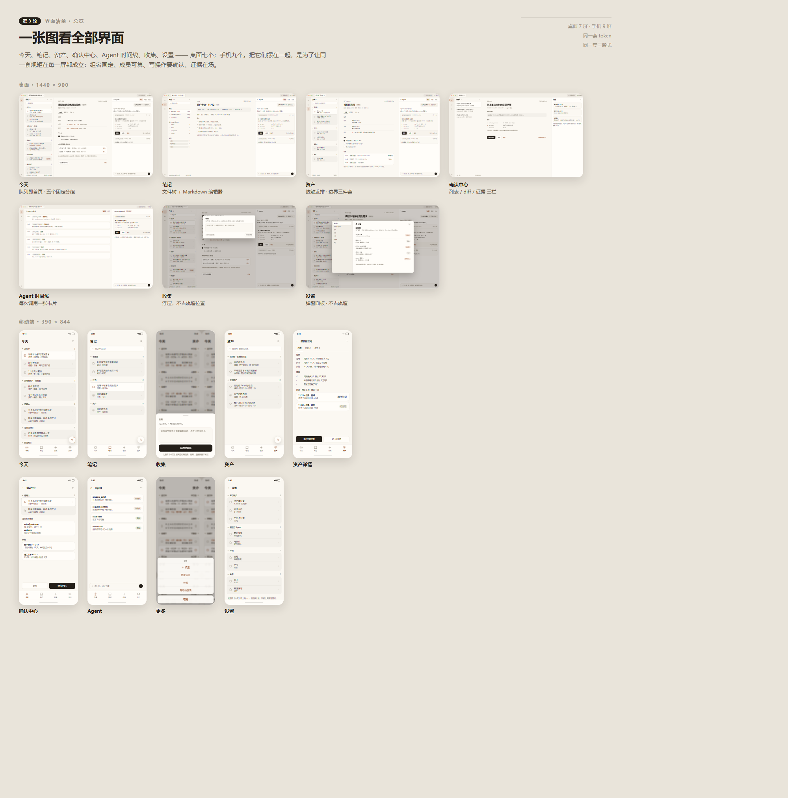
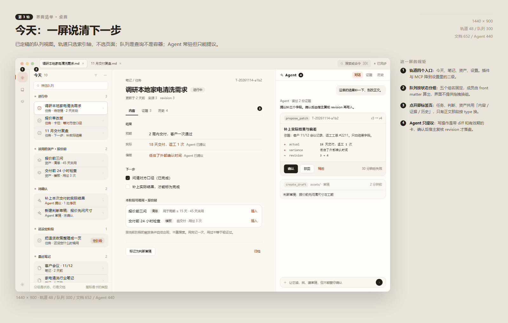
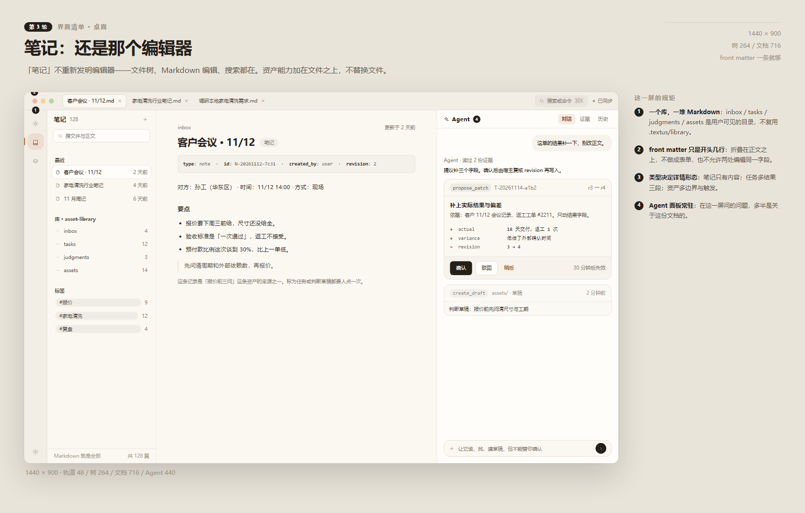
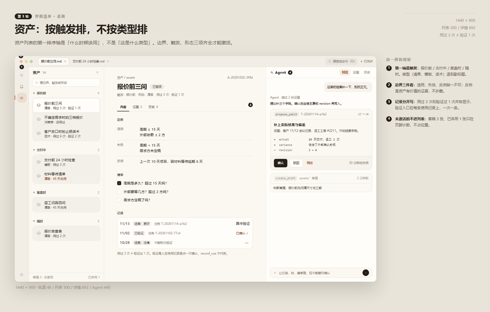
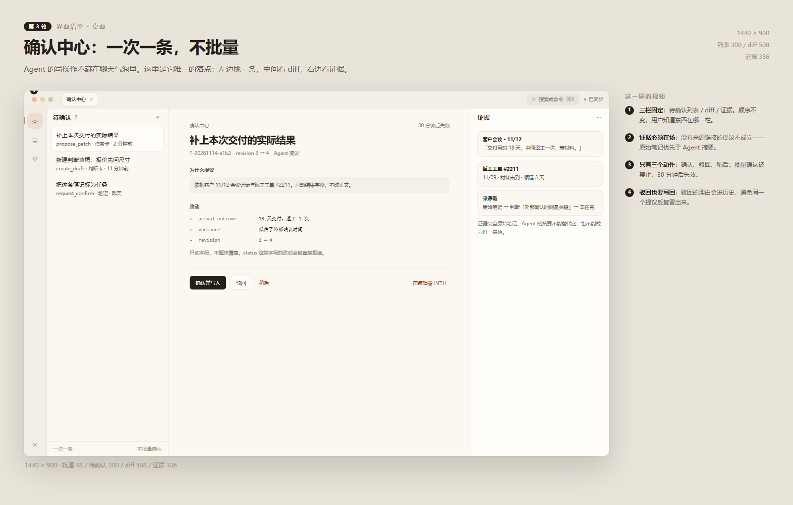
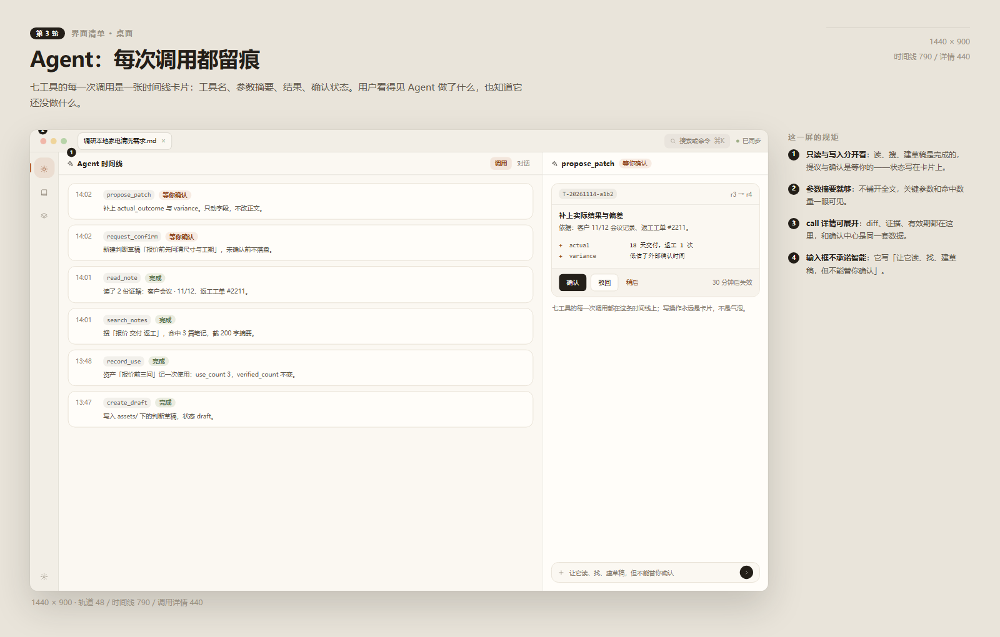
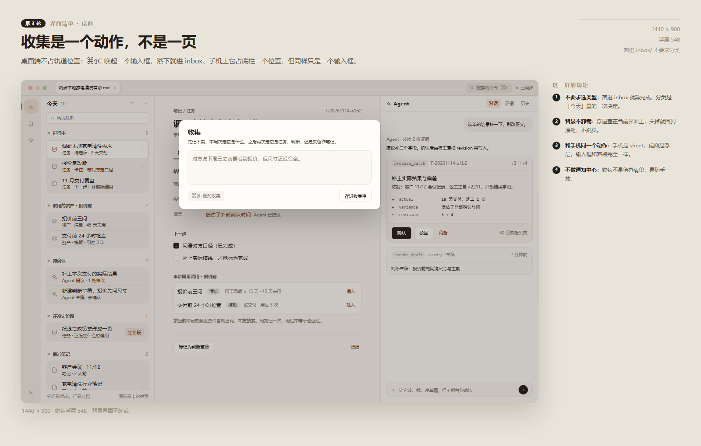
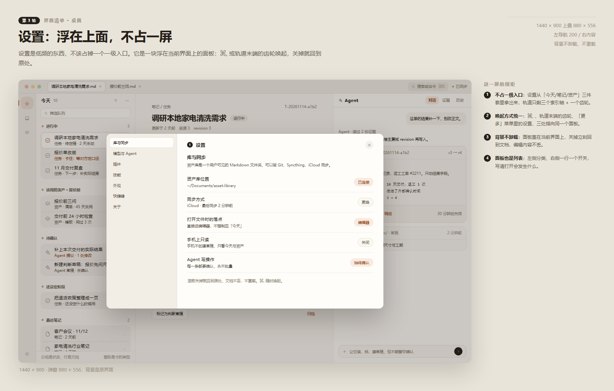
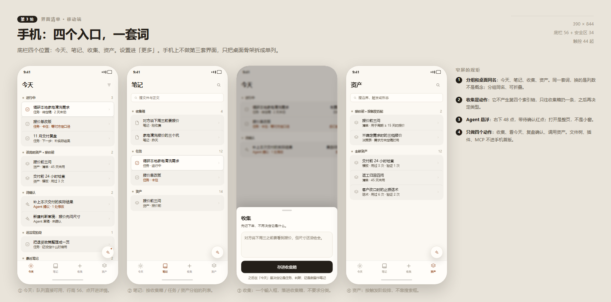
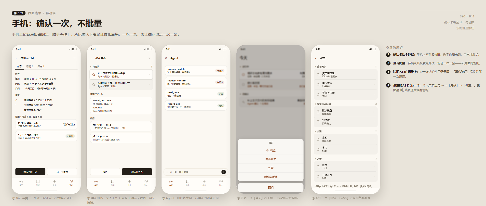

# 界面画板 · 历史参考（2026-11-17 封存）

> **已封存（裁决 29，2026-11-17）**：本目录**非权威、不施工、不勘误**。以下画板只作历史参考，**不是当前目标**；当前界面路线 = 小改宿主＋插件优先，见 [README](../README.md) §三与[任务清单](../05-状态/Textus-改造任务清单.md)。重启十屏 IA 需先改裁决（《界面改造方案》§4.6）。
>
> 入库 2026-11-16 · 清理 2026-11-16：删除非目标材料，只留 `screens/`（下有删除留档）· **评审修订 2026-11-16**：源值按《界面改造方案》§4.4 裁决 14–25 收敛（圆角归 {2 · 4 · 8 · 14 · pill}、半像素字号废除、系统字体栈、悬浮钮 48），注记数值以 HTML 实测为准，PNG 同批重渲染替换；`ui-all` 里的设备外壳插画圆角（48px）是装置插画，不属界面 token 词汇 · **迁移 2026-11-17**：本目录随 fork 文档重组迁至 `docs/skein/04-boards/`；上游 design-language 随 `docs/design/` 删除，退出权威链；同日移除误入库的扫描器状态（`.mimosa/`）· **封存 2026-11-17**：裁决 29 停用画板权威链。

## 地位（已封存）

- `screens/` 十屏是**历史目标稿**，不再是“唯一设计权威”；画板声明的尺寸只作历史参考。
- 权威顺序已停用；当前界面决策以《界面改造方案》§4 裁决与宿主现状为准。
- **源文件是数值的唯一出处**（历史说明）：图上量出的数可能带误差，要精确值就打开同名 HTML。
- 不再新增画板；重启 IA 前先改裁决。

## 已删除的材料（别找，别当目标）

2026-11-16 清理，以下四个目录已从仓库删除（git 历史可查）：

| 删掉的目录   | 曾是什么                                       | 为什么删                                                                                              |
| ------------ | ---------------------------------------------- | ----------------------------------------------------------------------------------------------------- |
| `directions/`| 三份方向稿（A 连续面已被 screens 取代；B/C 未批准）| 未批准稿曾被误当目标（2026-11-16 评审事故的成因）                                                    |
| `skeleton/`  | A 方案骨架五张（断点阶梯、行与三段式等）        | 推导材料；断点与行的落地数值已收入《界面改造方案》§2.2                                                |
| `shots/`     | 旧实现的落地截图九张                            | 旧实现不是参照物；证据以任务清单里的提交号为准，旧图 git 历史 v0.2 之前可查                            |
| `skins/`     | 四款配色对照（石墨 / 亮纸 / 苹果 / Craft）      | 裁决 13：留作未来主题库参考、不入当前工作线（裁决原文见《界面改造方案》§4.3；对照文件本体已删）        |

## 界面清单（screens/ 十屏 · 历史）

桌面七屏 + 手机两板 + 总览，同一套 token、同一条三段式。

### 总览：一张图看全部界面

### 桌面 · 今天 —— 队列即首页，五个固定分组

### 桌面 · 笔记 —— 文件树 + Markdown 编辑器（编辑区单岛平铺，裁决 12）

### 桌面 · 资产 —— 按触发排，边界三件套

### 桌面 · 确认中心 —— 列表 / diff / 证据三栏

### 桌面 · Agent 时间线 —— 每次调用一张卡片

### 桌面 · 收集 —— 浮层，不占轨道位置

### 桌面 · 设置 —— 弹窗面板，不占一轨

### 移动端 · 今天 / 笔记 / 收集 / 资产 —— 底栏 56 + 安全区 34，触栏 44 起

### 移动端 · 详情 / 确认 / Agent / 更多 / 设置

## 配套施工稿（`04-boards/` 根下，不是十屏之一）

- [今天页v3设计稿.html](今天页v3设计稿.html) / [今天页v3设计稿.png](今天页v3设计稿.png)（2026-11-16）：把 `ui-d-today` 的队列落到当时空数据状态上的落地稿。**历史参考，已随 C 组封存**；今天屏已回退到宿主现状，不再以它为准。

## 怎么用这份画板（封存后）

1. **不要照此施工**：本目录已封存；当前界面任务见[任务清单](../05-状态/Textus-改造任务清单.md)。
2. 需要重启十屏 IA 时，先在《界面改造方案》§4 改裁决，再解封本目录并重新指定权威。
3. 历史对照时注意：画板含用户判定为“凭空 / 错位”的成分，只能作参考，不能作为验收基准。
